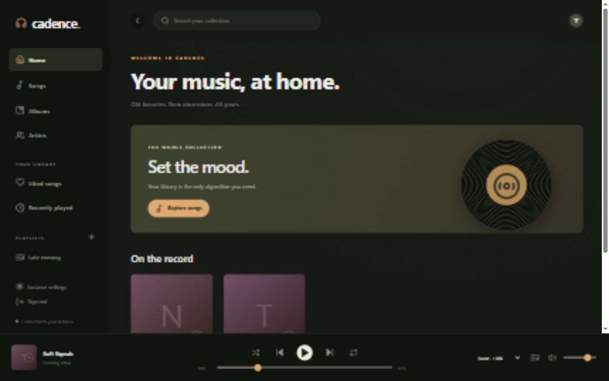
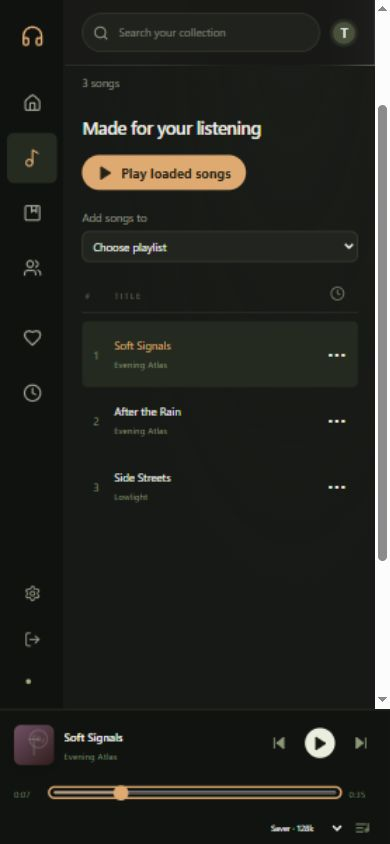

# Validation record

## Lossless playback (2026-10-10)

- Added Lossless playback for original FLAC, ALAC, and uncompressed PCM sources, with MP3 exceptions for one queue occurrence or the open session. Other lossy/unknown sources stay blocked; unsupported originals never fall back automatically to MP3.
- Go tests and vet passed. New tests cover codec classification, original GET/HEAD streaming and byte ranges, lossy-source rejection, authentication/access/path boundaries, and real FFmpeg/FFprobe FLAC fixtures with lowercase and uppercase extensions and embedded metadata. PostgreSQL integration tests were skipped because `TEST_DATABASE_URL` was not configured for this run.
- Frontend: 71 tests across 15 files, TypeScript, and the production Vite build passed. New playback tests cover strict blocking, stale prompts/loads, per-occurrence and session MP3 permission, reset/revocation, skip/repeat behavior, paused restoration and seeking, original-only offline caches, decoder rejection, Auto fallback, and listening-history accounting. OpenAPI validation passed with 64 documented paths. The build retains its bundle-size warning.
- Chromium checks used isolated API fixtures and real generated FLAC/MP3 audio at 1280, 390, and 320 pixels. Original FLAC playback and seeking, paused controls, MP3 prompts/overrides, and permission revocation passed without browser runtime errors or document overflow. Desktop and mobile prompt screenshots were inspected; mobile prompt placement/wrapping was corrected. QA scripts, audio, and screenshots remain in ignored `.local/lossless-qa/`.
- Browser checks did not use a live database/server, physical devices, other browsers, or real ALAC/PCM audio. Lossless describes source preservation, not recording provenance or the device output path.

## Soulseek integration (2026-10-10)

- `go test -race ./...` passed with an isolated UTF-8 PostgreSQL database, and `go vet ./...` passed. New checks cover durable settings/private import markers, stale-write rejection, search ownership, session/CSRF/admin enforcement, access revocation, user/group routing precedence, both review timings, automatic-rule bypass, destination removal, retries, partial enqueue cancellation, staging cleanup across attempts, restart recovery, import collisions, symlink escapes, and exclusion of staging from scans.
- Generated MP3, FLAC, and M4A fixtures passed real FFprobe audio validation and import checks. Import publication uses hard links within the destination filesystem and never overwrites existing files; destinations without hard-link support hold imports for attention. Windows disallowed creation of the symlink fixture; the containment test passed separately in a Linux Go container.
- Frontend: 39 tests across 12 files passed, and TypeScript/production Vite build passed. Optional Soulseek views are loaded separately. OpenAPI validation passed with 64 documented paths. Secret-generation tests passed and verified preservation of existing database/network credentials and generated secrets across repeated runs.
- Chromium API-fixture checks passed at 1280 × 844 and 390 × 844: external searches occur only on explicit submission; complete album listings include songs absent from search matches; request/approval controls, ordered group routing, review timing, sharing configuration, combined/separate search presentation, and permission revocation worked without browser runtime errors or horizontal overflow. Desktop/phone screenshots were inspected; screenshots and harnesses stay in ignored `.local/`.
- Both base and optional Compose configurations validated. The complete Go/React image built successfully, and an isolated app/PostgreSQL/slskd stack started from fresh volumes with slskd 0.26.0. Shared-volume initialization was verified for UID/GID 10001. Real slskd API-key/JWT authentication and sharing add/remove calls passed. Administrator setup and persisted integration settings worked, and Cadence remained healthy with slskd stopped and when recreated using base Compose alone.
- Live Soulseek peer searches, queue negotiation, and network file transfers were not tested: container checks disabled network connection and used isolated fixture credentials. Search/folder/transfer behavior is covered by fake API fixtures. No user's Soulseek account, music files, or existing deployment configuration was changed.

Validated locally on Windows with an AMD Ryzen 5 2600 (6 cores), PostgreSQL 17.11, Go 1.26.9, Node 22.16, and FFmpeg 6.0. This describes observed checks, not a universal capacity guarantee.

- `go test -race ./...`: passed with a real disposable PostgreSQL database. Includes repository contracts, one-time setup/login, CSRF/origin rejection, private playlists, group exclusions, scan errors, unavailable mounts, source-file preservation, catalog override persistence, range seeking, simultaneous media requests, migration re-entry, and cache limits/cancellation.
- `go vet ./...`: passed.
- Frontend: TypeScript check, production Vite build, and three cache tests passed.
- `node scripts/check-openapi.mjs`: passed, 32 documented paths.
- `npm audit`: zero reported vulnerabilities. `govulncheck` using Go 1.26.9: zero vulnerabilities reachable from project code; one advisory remains in a required module for code paths the application does not invoke.
- `docker compose --env-file .env.example config --quiet`: passed. Official Go/Node base-image manifests resolved. A full container build/run was not tested locally because Docker Desktop's engine was not running; CI includes a container build.
- Real PostgreSQL custom-format backup and restore into a separate database preserved 1 test account, 3 generated audio tracks, 1 playlist, 1 like, and 8 recorded play events.
- In-app Chromium browser checks: first-run setup, original and 128 kbps converted playback, keyboard seeking, quality switching while paused with position preserved, mobile playlist creation, playlist membership, likes, rescans, and navigation. Cached audio played successfully after the Go server was stopped; the client displayed Offline session.
- Responsive views checked at 390 × 844 and 1280 × 800. Screenshots use generated sine-wave test fixtures, not a real music collection.

## Account and interaction update (2026-10-09)

- `npm test`: all three existing cache tests passed. `npm run build`: TypeScript checking and production Vite build passed. The project has no configured lint command; modified frontend files were checked with Prettier.
- Headless Chromium checks with isolated API fixtures passed at 1280 × 844, 900 × 844, and 390 × 844: avatar toggling, keyboard opening and arrow navigation, Escape and outside-click dismissal, profile details, dialog focus restoration and modal keyboard containment, immediate quality/volume changes, queue access, queue and playlist-add feedback, administrator navigation, hidden administration for listener accounts, and sign-out returning to sign-in.
- Desktop and mobile profile, listening-settings, and account-menu screenshots were visually inspected. Checks ran with reduced motion enabled and found no horizontal page overflow or browser runtime errors.
- Browser API responses were fixtures. These checks do not revalidate live backend logout, authorization enforcement, streaming, or transcoding. Profile editing and durable preference storage were not added. Temporary scripts and screenshots remain in ignored `.local/`.

## Playback controls and playlist dialog update (2026-10-09)

- Frontend: five tests passed, including dB/gain conversion, mute, full gain, and equal gain ratios for equal slider steps. TypeScript checking, production Vite build, and Prettier checks passed. No additional UI dependency was introduced.
- Go tests passed with race detection against a separate disposable PostgreSQL database. Go vet and the OpenAPI checker passed. Added tests cover playlist icon validation, API defaults and rejection, persistence, and upgrading existing playlists with a default icon. Scanner/HTTP integration checks also passed.
- Chromium fixture checks passed at 1280 × 844, 900 × 844, and 390 × 844: actual audio-element gain, volume popup, mute/unmute, keyboard quality selection, nested Escape dismissal, playlist icon/name selection, failed-save recovery, creation and reload, independently scrolling queue, and narrow-screen queue layout. No horizontal page overflow or browser runtime errors occurred. Dialogs, dropdowns, popups, and desktop/mobile queue layouts were visually reviewed.
- UI checks used isolated API fixtures; backend playlist checks used real PostgreSQL. Cross-browser and physical-device listening checks remain outside this update. Temporary browser scripts, screenshots, and test data stay in ignored `.local/`.

## People administrator checkbox update (2026-10-09)

- Replaced the administrator field with a themed checkbox component: 24-pixel check indicator, a larger clickable label, permission description, visible keyboard focus, and disabled styling. Native checkbox semantics and FormData behavior are preserved.
- Five frontend tests, TypeScript/production build, and Prettier checks passed. Chromium fixture checks at 1280 × 844 and 390 × 844 passed for label and Space-key toggling, visual checked state, disabling during submission, true/false administrator payloads, form reset, and no horizontal overflow or runtime errors. Desktop and mobile screenshots were reviewed. Account creation responses were fixtures; backend behavior was unchanged.

## Account editing update (2026-10-09)

- Added persistent avatar storage and a migration preserving existing account names/passwords with empty-avatar defaults. Avatars are authenticated JPEG responses; uploaded JPEG/PNG data is bounded by byte/dimension/pixel limits, cropped, resized, and re-encoded.
- Go tests passed with race detection and a separate disposable PostgreSQL database. Tests cover wrong/missing current passwords, password bounds, preserved current session, revocation of other sessions, administrator resets/revocation, stale-password login protection, CSRF and non-admin rejection, name normalization, username conflicts, atomic username/group rollback, avatar upload/removal/versioning, private avatar reads, invalid/oversized images, and avatar migration. Go vet and the OpenAPI checker passed with 38 documented paths.
- Frontend tests, TypeScript/production build, and Prettier checks passed. Chromium fixture checks at 1280 × 844 and 390 × 844 passed for profile name/avatar changes, immediate header updates, password confirmation and current-password errors, password-field clearing on success, clickable user rows, group/username edits, save-error recovery, administrator reset without current password, session revocation, avatar removal, focus restoration, account refresh on focus, self-reset sign-out, and no page overflow/runtime errors. Profile and user-editor screenshots were visually reviewed.
- Browser requests used isolated fixtures; backend account checks used real PostgreSQL. Cross-browser, physical-device avatar picking, and simultaneous multi-device UI refresh remain outside this update. Temporary scripts, images, and databases were excluded from Git.

## Modal dismissal update (2026-10-09)

- Account/profile, listening settings, user editor, and playlist dialogs now dismiss on an outside click or tap. Both ends of a pointer gesture must be outside; dialog padding, scrollbars, and drags from inside do not dismiss. Pending saves continue to block dismissal.
- Frontend tests, TypeScript/production build, formatting, and diff checks passed. Chromium fixture checks at desktop and phone widths passed for dismissal, focus restoration, padding, drag gestures, and pending-save protection. The desktop-only playlist trigger was invoked programmatically at phone width to check its dialog. Cross-browser and physical touchscreen checks were not run.

## Compact profile update (2026-10-09)

- Replaced separate avatar/name sections with a clickable avatar supporting dropped replacements, an explicit removal confirmation, and inline display-name editing. Password fields expand on demand. Administrator account fields and session controls remain available.
- Frontend tests, TypeScript/production build, formatting, and diff checks passed. Chromium API-fixture checks at 1280 and 390 pixels passed for name saves, avatar file selection/drop/removal/cancellation, password checks, and administrator editing. Profile dialogs had no internal overflow at the tested 844-pixel height, including expanded password fields; the phone screenshot was visually reviewed. Shorter viewports can still scroll to keep controls reachable. Physical touchscreen/file-picker and cross-browser checks were not run.

## URL navigation update (2026-10-09)

- Library collections, album/artist details, playlists, and administrator tabs use URL paths; searches use query parameters. Refresh and Back/Forward restore the route. Direct links survive the sign-in screen, and non-admin accounts are redirected out of administrator paths. Unknown/malformed paths recover to Home.
- Seven frontend tests, TypeScript/production build, formatting, and diff checks passed. URL tests cover encoded identifiers, Unicode, search punctuation, malformed URLs, and canonical routes. HTTP API race tests passed, including serving nested frontend paths while preserving API 404s.
- Chromium API-fixture checks at 1280 and 390 pixels passed for collection/detail refreshes, correct album/artist/playlist filters, encoded artist names, search restoration/clearing, administrator tab navigation, browser Back/Forward, direct-link sign-in return, and permission redirects, with no runtime errors or horizontal overflow. Cross-browser and live full-stack browser checks were not run.

## Queue, filename detection, and metadata editor update (2026-10-09)

- Queue moves are limited to upcoming songs; played/current positions remain fixed. Disabled arrow controls and the player enforce the same boundary. Filename fallback recognizes common artist/title download names, marked reversed names, movie credits, video labels, and YouTube IDs; embedded tags, meaningful parentheses, and featured credits are preserved.
- Replaced raw track-ID suggestion/restore forms with library search, song selection, eight editable metadata fields, multi-field suggestions, and per-field restoration. Partial saves retain unsaved edits without resubmitting successful fields. Added track/disc overrides, numeric validation, blank optional metadata, and migration 5 with an updated sort index.
- Eight frontend tests, TypeScript/production build, formatting, OpenAPI checks, Go vet, and the Go race suite passed with a disposable PostgreSQL database. Filename cases, FFprobe embedded-tag precedence, API bounds, numeric/blank overrides, full-scan preservation, extracted-value restoration, and migration preservation were checked. Chromium API-fixture checks at desktop/phone widths passed for queue boundaries, upcoming moves, metadata search/error recovery, populated fields, partial-save retry, numeric/blank values, restoration, and no horizontal overflow/runtime errors; editor screenshots were reviewed. Cross-browser and live full-stack browser checks were not run. Personal filename listings and test artifacts stay in ignored `.local/`.

## Live lyrics update (2026-10-09)

- Added Queue/Lyrics tabs and a microphone shortcut. LRC timestamps highlight the current line, support offsets/repeated timestamps, follow playback, and seek on click. Plain lyrics, instrumental tracks, missing lyrics, retries, and stale-response protection are included. Seeking updates the visible playback position immediately, including while paused.
- Authenticated server lookups use current accessible track metadata and check track access again after the external response. LRCLIB requests have timeouts, bounded response/cache sizes, serialized throttling, metadata-keyed positive/negative caches, and Retry-After backoff. No audio uploads, new database storage, or background library-wide lyrics requests were added.
- Ten frontend tests, TypeScript/production build, formatting, OpenAPI checks (39 paths), Go vet, and Go race checks passed. Backend tests cover authentication/exclusions even for cached lyrics, permission changes during lookup, metadata encoding, album fallback, positive/negative caching, concurrent request coalescing, instrumental handling, response bounds, and rate-limit backoff. PostgreSQL integration cases were skipped in this run; database code was unchanged.
- Chromium API-fixture checks at desktop/phone widths passed for synchronized highlights, forward/backward seeking while paused, auto-scroll/follow, keyboard tabs, plain/instrumental/missing/error/retry states, current-song changes, stale responses, and no runtime errors or horizontal overflow. Screenshots were visually reviewed. A read-only live LRCLIB request returned HTTP 503 (server busy); successful live-provider matching and cross-browser/device testing were not verified.

## Field-selectable bulk acceptance update (2026-10-09)

- Added themed metadata field choices, select-all/clear controls, and an Accept all action in Review changes. It covers pending rows beyond pagination, reports the accepted count, keeps unselected fields pending, and refreshes the review/search data. Conflicting suggestions use the newest value. Retry clears the preceding error and preserves field choices.
- Ten frontend tests, TypeScript/production build, formatting, OpenAPI validation (40 paths), Go vet, and the full Go race suite passed with a disposable PostgreSQL database. Added tests cover authentication/admin/CSRF enforcement, invalid selections, 107 changes beyond the 100-row page, field isolation, newest-value conflicts, repeat acceptance, and transaction rollback without partial updates.
- Chromium API-fixture checks at desktop/phone widths passed for field choices, disabled empty selection, failed-save retry, busy controls, acceptance of unloaded titles, preservation of artist suggestions, select-all behavior, success counts, and no runtime errors/horizontal overflow. The phone layout was visually reviewed. Cross-browser and live full-stack browser checks were not run.

## Automatic mini-player update (2026-10-09)

- Added a default-on, per-user browser preference in Listening settings and a manual player-bar shortcut. Native Document PiP displays the same audio player's track, transport, seek, and logarithmic volume controls through a React portal. Automatic Media Session requests require active playback; returning closes automatic windows, manual windows remain open, and sign-out/empty playback closes either. Hidden-window dismissal suppresses repeated automatic opening until the tab is visible again. Pending requests are checked against current user, playback, preference, and visibility before attaching controls.
- Ten frontend tests, TypeScript/production build, formatting, and diff checks passed. Chromium API-fixture checks at desktop/phone widths exercised real native PiP windows, shared transport/seek/dB gain, track changes, preference defaults/persistence/account isolation, manual paused opening, permission rejection, sign-out, and unsupported API/action/storage fallbacks. The mini-player was checked and visually reviewed at 360 by 280 pixels with no horizontal overflow or scrollbar at that size.
- Automatic callback/visibility, repeated-dismissal, and delayed-request cases were driven deterministically in the browser while using native PiP windows. Real browser-triggered automatic eligibility/site permission prompts, cross-browser behavior, live full-stack playback, and physical mobile devices were not verified. Document PiP requires a secure context (HTTPS or localhost); unsupported browsers retain system media controls. Browser permission and media eligibility rules still determine whether automatic opening occurs: see [Chrome's guidance](https://developer.chrome.com/blog/automatic-picture-in-picture-media-playback).

## Cross-device playback resume update (2026-10-09)

- Added per-account server checkpoints with migration 6 and authenticated GET/PUT `/me/playback`. The frontend restores the last accessible song and fractional position paused, saves every 10 seconds during playback and on playback changes/hidden/pagehide, and uses CSRF-protected keepalive requests plus local recovery for interrupted saves. New user playback takes precedence over a delayed restore. Removed/excluded songs do not block library use.
- Writer sequence numbers reject out-of-order updates from a tab, and server revisions protect device takeover from stale requests. Fourteen frontend tests, TypeScript/production build, formatting, OpenAPI validation (41 paths), Go vet, and the full database-backed Go race suite passed. Tests cover authentication/CSRF, invalid checkpoints, account isolation, inaccessible tracks, duration clamping, delayed updates, simultaneous device takeover, track deletion, and persistence across repository reopening/migration checks.
- Chromium API-fixture checks at desktop/phone widths passed for accidental reload recovery, paused restoration without autoplay/history writes, a fresh browser context resuming server progress, backward seek, exact fractional pagehide checkpoints with keepalive/CSRF, periodic saving, interrupted-save recovery/later sync, inactive-tab protection, separate accounts, inaccessible tracks, and delayed restore versus user playback. Real close-time delivery against a live server, abrupt termination, cross-browser/device testing, and physical mobile devices were not verified. Final unload delivery is best effort; previous checkpoints provide recovery, and offline progress reaches other devices after syncing.

## Safari dropdown activation fix (2026-10-09)

- Replaced blur-based dismissal with shared outside pointer/focus handling for the account menu and quality selector. A null focus destination no longer unmounts a tapped item before its click runs. Escape also closes the account menu when focus is on its trigger. This addresses Safari's [button focus behavior](https://developer.mozilla.org/en-US/docs/Web/HTML/Reference/Elements/button#clicking_and_focus).
- Reproduced the previous Instance settings failure at desktop/phone widths by simulating Safari's button blur without focusing the tapped button. After the fix, Chromium touch checks passed at 1280 and 390 pixels for administrator navigation/refresh, profile/listening settings/queue/sign-out, quality choices, null blur, outside focus/tap dismissal, keyboard navigation/activation/Escape, and no runtime errors or horizontal overflow. Fourteen frontend tests, TypeScript/production build, formatting, and diff checks passed. Native WebKit tooling was unavailable; physical iOS Safari was not tested.

## Individual artist credits update (2026-10-09)

- Comma-separated performer credits now create individual artist memberships and links in song rows, now-playing, queue, lyrics, and native PiP. Links preserve URL encoding, normal new-tab gestures, and uninterrupted playback. Queue/lyrics artist navigation closes the panel so the artist page is visible on phones. Source metadata remains intact, while trimmed names, empty credits, and exact duplicates are normalized for display/counts; other separators are preserved.
- Migration 7 adds an immutable artist-name function and a GIN index on effective credits. Existing songs and accepted overrides immediately participate in individual artist listing/filtering without rescanning. Fifteen frontend tests, TypeScript/production build, formatting, OpenAPI validation (41 paths), Go vet, and the full database-backed race suite passed. Artist tests cover collaborations, duplicate credits/counts, exact matching, pagination, Unicode/punctuation, unknown artists, existing-catalog upgrade, overrides/restoration, exclusions, and repository reopening.
- Chromium API-fixture checks at 1280 and 390 pixels passed for separate links, encoded routes and filters, refresh/Back, player/queue/lyrics/native PiP navigation, continued playback, no nested interactive elements, and no runtime errors or horizontal overflow. Phone and 360 by 280 mini-player screenshots were visually reviewed. Cross-browser, physical-device, and live full-stack browser checks were not run.

## Catalog benchmark

PostgreSQL seeded with 250,000 synthetic catalog rows; three iterations per case, warm cache. These are catalog measurements, not timing of 250,000 FFprobe filesystem scans.

| Operation                                 |    Mean |
| ----------------------------------------- | ------: |
| First 100 tracks with full-library count  | 70.3 ms |
| Exact-word full-text search               |  4.9 ms |
| Batch of 20 concurrent full-text searches | 16.6 ms |

An additional integration scenario passed 20 concurrent audio range requests sharing a 320 kbps conversion. Sustained bandwidth, 20 distinct concurrent transcodes, browser-specific codec behavior, and end-to-end 250,000-file scan duration remain deployment-dependent.

## Remaining release checks

Run the complete Compose stack on a Docker-enabled machine and verify ownership of real read-only music mounts. Cross-browser playback still needs dedicated Firefox, Safari, iOS, and Android device checks; the in-app Chromium test is not a substitute for those. Live external metadata-provider responses were not exercised: enrichment was tested with a controlled HTTP transport and is off by default.

## Whole-frontend design and accessibility pass (2026-10-09)

- Frontend unit tests: 15 passed across seven files. TypeScript checking, Vite production build, Prettier, and whitespace checks passed.
- Chromium API-fixture checks passed at 1280, 900, 390, and 320 pixels: skip link, heading focus, Cmd/Ctrl+K, app/browser Back, protected playback shortcuts, keyboard administrator tabs, song menus, outside/Escape dismissal, playlist search/addition, and creating a playlist then returning to the originating song.
- Automated axe-core checks using WCAG 2 A/AA, 2.1 AA, and 2.2 AA tags reported no violations on the 13 library/admin routes and eight account/dialog/player surfaces at 1280, 390, and 320 pixels. Queue title targets and mobile seek spacing were corrected based on the initial failures. Further checks passed for the administrator user editor, expanded password reset/change forms, inline display-name editing, quality options, and sign-in.
- Verified Cmd/Ctrl+K from the mobile queue, reduced-motion rendering, and visible focus under forced colors. Safari-style null-blur regression checks passed at desktop and phone widths for account/quality menus and administrator navigation.
- Screenshots of desktop/phone song views, narrow administrator views, compact profiles, and lyrics were visually reviewed. Browser fixtures and downloaded QA dependencies remain ignored under `.local`; no generated tools or screenshots were committed.
- These are automated Chromium and fixture checks, not a certification of WCAG conformance. VoiceOver/NVDA and physical Safari/iOS/Android testing, real account mutations, live lyrics-provider responses, and real playback on these devices were not exercised in this pass. Backend behavior was unchanged.

## Collection loading and mutation follow-up (2026-10-09)

- Chromium fixtures at 1280 and 390 pixels deliberately failed/delayed collection requests. Switching collections removed previous rows and their play action immediately; retry showed only the newly requested collection. Delayed/failed likes disabled the like action, repeated clicks issued one request, unrelated menu actions retained keyboard focus, and failed saves left the original liked state intact and recoverable.
- Build and all 15 frontend tests passed. The full route/dialog accessibility sweep was repeated after introducing loading placeholders and retry controls. QA used controlled API responses; production network behavior and real account changes were not tested.

## shadcn/ui integration (2026-10-09)

- Frontend production build/TypeScript and all 15 tests across seven files passed. Dependency installation reported zero npm audit vulnerabilities. Updated the exact npm license inventory and retained shadcn's MIT notice.
- Chromium API-fixture checks passed at 1280, 900, 390, and 320 pixels for navigation, song-menu keyboard/Escape/focus handling, playlist searching/adding/creation-and-return, queue actions, outside dismissal, admin tabs, and no runtime errors or horizontal overflow.
- Additional checks at 1280 and 390 pixels passed for account-menu keyboard navigation, menu-to-profile/settings dialogs, focus restoration to the account trigger, outside dismissal, pending playlist save protection against Escape/outside clicks, failed-save recovery preserving input, and responsive layout. Desktop profile and phone playlist screenshots were visually reviewed.
- Existing profile regression fixtures also passed at desktop/phone widths for name/avatar/password saves and error recovery, administrator editing/reset/revocation, and focus restoration. Their stale admin button selector was updated to the current tab role in the ignored fixture script.
- Browser checks use isolated API/media fixtures. Live server saves/playback, cross-browser behavior, and physical touch devices were not verified. Backend code was unchanged. Vite build/test subprocesses and Chromium needed execution outside the restricted sandbox.

## Resizable playback panel (2026-10-09)

- TypeScript/production build and all 18 tests across eight files passed, including constraints, viewport clamping, invalid sizes, and minimum dimensions. Formatting and diff checks passed.
- Chromium API/media fixtures passed at 1440, 1280, 1100, 900, 390, and 320px widths for pointer dragging, keyboard increments/reset/min/max, expand/restore, library/panel minima, queue/lyrics shared sizing, close/reopen, reload persistence, responsive breakpoint changes, and no runtime errors or horizontal page overflow. Desktop and phone lyrics screenshots were visually reviewed.
- Short viewport checks at 390x500 and 1280x260 passed for minimum heights, reachable player controls, and unavailable browser storage. Existing lyrics fixtures passed at desktop/phone widths for highlighting, seeking while paused, scrolling/follow, plain/instrumental/missing/error/retry states, track changes, and stale response protection.
- Browser checks use fixtures; live backend/media, cross-browser testing, and physical touch dragging were not verified. Backend code and dependencies were unchanged.

## HTTP mini-player popout fix (2026-10-09)

- Native Document PiP is unavailable on ordinary HTTP LAN addresses. The manual mini-player controls now remain available and synchronously open a regular popout when native PiP is unavailable. It shares the existing React player, styles, playback/seek/volume controls, and track updates. Automatic PiP remains limited to supported secure contexts; settings explain the HTTP/browser fallback.
- Native Chromium PiP regression fixtures passed at 1280 and 390px for manual/automatic opening, preferences, shared controls, permission errors, deferred requests, cleanup, and sign-out. Insecure HTTP-origin fixtures passed at desktop/phone widths for real popup opening, shared play/pause/seek/track changes, window reuse, settings launch, automatic-option disablement, and sign-out. Blocked-popup feedback/retry and parent reload cleanup passed separately. The popout screenshot was visually reviewed.
- Frontend build/TypeScript, all 18 tests, formatting, and diff checks passed. Tests used isolated API/media fixtures and an insecure HTTP test hostname; the user's live LAN server, physical mobile popup behavior, and other browsers were not verified. A regular popout has no always-on-top guarantee.

## Missing-metadata rescan flag (2026-10-09)

- Added the admin checkbox and POST /admin/scans `missingOnly` flag. It re-probes unchanged incomplete tracks and new files, skips complete tracks even if `full` is supplied, and marks skipped files seen so root reconciliation preserves their availability. Selection reads effective catalog fields including accepted overrides and checks artwork file availability. Optional year/genre/numbers do not make a track incomplete. Existing source-file and accepted-override preservation still applies.
- Go tests and vet passed. The full Go race suite passed with a separate disposable PostgreSQL database, including real FFmpeg/FFprobe selection tests, complete-track skipping with both full flag values, unknown/blank fields, missing/deleted/directory artwork, lookup-error safety, and effective accepted metadata retrieval. Existing scanner, API permissions, and override-preservation integration tests passed.
- Frontend build/TypeScript, all 18 tests, formatting/diff checks, and OpenAPI validation (41 paths) passed. Chromium API-fixture checks at desktop/phone widths verified flag payloads, mutually exclusive full/missing-only UI selection, and no runtime errors or page overflow. The phone layout was visually reviewed.
- External enrichment providers and the user's live music library were not scanned. Missing-only retries can remain eligible when source metadata/artwork is still unavailable; enabling enrichment remains a separate setting. Browser checks used isolated fixtures.

## Screen-centered player (2026-10-09)

- Balanced the desktop player columns so transport/seek controls center on the screen independently of track details and audio settings. Tablet transport uses the centered grid column; phone controls retain their existing stacked layout.
- Production build/TypeScript, formatting, and diff checks passed. Chromium API/media fixtures at 1920, 1440, 1280, 1101, 1100, 900, 701, 390, and 320px confirmed transport center within one pixel of screen center, both with and without the queue, plus reachable utility controls and no runtime errors or horizontal page overflow. The desktop screenshot was visually reviewed.
- Cross-browser and physical-device checks were not run. This change affects CSS layout only.

## Artist profiles and artist-scoped metadata refresh (2026-10-09)

- Added migration 8 for saved artist profiles, GET /artists/profile, and admin-only POST /admin/artists/profile. Explicit identified MusicBrainz lookups provide facts, deduplicated genres, and source links. Linked English Wikipedia/Wikidata pages provide plain-text biographies and Wikimedia photo URLs with source/license links. Ambiguous or unreliable name matches require an explicit MusicBrainz UUID. Timeouts, response-size limits, HTTPS link filtering, partial-provider warnings, and preservation of saved biography/photo data during transient Wikimedia failure are included.
- Artist pages display saved data for listeners and provide administrator fetch/update and song-refresh actions. Profile fetching is separate from the global song-enrichment setting. Song refresh passes the artist filter and full/missing-only choices; matching uses individual comma-separated credits and effective accepted artist metadata. Unrelated files are marked seen and retained, and accepted source corrections remain preserved.
- Full Go race suite and Go vet passed with a disposable PostgreSQL database. Tests cover migration/persistence, authentication/admin/CSRF enforcement, accessible-artist checks including cached reads after track access disappears, exact/ambiguous name matching, Wikidata/Wikipedia biographies/images, unsafe links, oversized responses, partial-provider failure, artist scan selection, and accepted-name/fallback preservation. Frontend build/TypeScript, all 18 tests, formatting/diff checks, and OpenAPI validation (43 paths) passed.
- Chromium fixtures at desktop/phone widths passed for fetch/update, ambiguity errors preserving current data, UUID input, reload persistence, artist full/missing-only scan payloads, listener read-only controls, and no runtime errors/page overflow. The phone artist-profile layout was visually reviewed. External provider responses were mocked; successful live-provider availability/matching and physical-device/cross-browser behavior were not verified. No live library scan was started.
- Provider references: [MusicBrainz API](https://musicbrainz.org/doc/MusicBrainz_API), [artist search](https://musicbrainz.org/doc/MusicBrainz_API/Search), and [MediaWiki extracts/page images](https://www.mediawiki.org/wiki/API:Page_info_in_search_results).

## Server albums on artist pages (2026-10-09)

- Artist pages now list server albums independently of the loaded songs, with artwork, matching-song counts, album navigation, paginated loading, and retry/empty states. The albums API accepts an exact individual artist filter using effective metadata and comma-separated credits; existing permission and availability filtering applies before aggregation.
- Frontend build/TypeScript and all 18 tests, Go tests/vet, the full Go race suite against disposable PostgreSQL, OpenAPI validation, and diff checks passed. Database coverage includes collaborations, exact matching, accepted artist overrides, pagination, artwork, exclusions, and unavailable tracks.
- Chromium fixtures at 1280, 390, and 320px passed retry, pagination, album navigation, and overflow/runtime checks. The phone layout was visually reviewed. The live library and other browsers were not tested.

## Singles without album metadata (2026-10-09)

- Removed folder-name album inference. Blank/unknown albums classify as singles, omit album/albumId/albumArtist in track responses, and are excluded from album aggregation. Album clearing through accepted edits follows the same classification. Song tables, queue, main/mini players, and metadata search use the Single label; artwork falls back to song titles. Missing-only scans do not require album metadata for singles, and release enrichment skips them.
- Frontend build/TypeScript and all 18 frontend tests passed. Full Go race tests with disposable PostgreSQL and Go vet passed, including albumless probes, JSON omission/classification, missing-only completeness, database reads/aggregation, and cleared album overrides. Chromium fixtures at desktop/phone widths verified omitted-album rendering, playback, and no page overflow/runtime errors. OpenAPI/diff checks passed.
- The live server library was not rescanned. Previously synthesized folder albums require a full rescan; no reliable provenance exists in older catalog records to remove these without re-reading source files. Cross-browser/physical-device behavior was not verified.

## Queue text overflow (2026-10-09)

- Queue title buttons now fill their constrained text column and truncate with an ellipsis; full titles remain available on hover. Artist credits also truncate, action buttons retain their width, and the queue scrolls vertically without horizontal scrolling.
- Frontend build/TypeScript and diff checks passed. Chromium fixtures with long unbroken song titles and artist credits at 1440, 1280, 900, 390, and 320px verified minimum/maximum panel sizes, actual content width matching the container, text truncation, reachable controls, preserved vertical scrolling, and no page overflow/runtime errors. Other browsers and physical devices were not tested.

## Scrollbar theme (2026-10-09)

- Shared thin scrollbars now use muted green-gray thumbs with transparent tracks/corners, plus WebKit fallback styling. The app declares a dark native control color scheme; forced-colors mode retains system scrollbar colors. Removed the song list's separate scrollbar colors for consistent styling.
- Frontend build/TypeScript, formatting, and diff checks passed. Chromium fixtures verified computed scrollbar colors/width in document, main, song-list, and queue containers and automatic scrollbar colors in forced-colors mode; the desktop screenshot was visually reviewed. Firefox/Safari and physical devices were not tested.

## Metadata chooser and catalog folder browser (2026-10-09)

- Reviewed Stash’s ScrapeDialog/ScrapeDialogRow and Jellyfin’s web directory browser/metadata editor plus server EnvironmentController/ItemUpdateController. The independently implemented workflow uses per-field current/proposed comparison, source choice, editable proposed values, artwork previews, and Apply/Cancel. Reference links and design details are recorded in [METADATA_WORKFLOW.md](METADATA_WORKFLOW.md).
- The Suggestions tab now defaults to indexed folder browsing with breadcrumbs, file selection, pagination, error retry, and individual field editing; song search remains available. Dirty drafts prevent replacing the selected song until saved/discarded. Review cards group suggestions by song; opening a chooser retrieves all candidates for that song. Optional bulk acceptance remains in an expandable section.
- Added three admin APIs: catalog browsing, all pending candidates for a track, and atomic selected replacements. Permissions/availability filter roots, folder counts, and files. Windows paths and literal special characters are supported. Transactions reject stale current values, foreign/resolved candidates, and conflicting field choices; kept fields remain pending, competing replaced-field proposals are dismissed, and administrator edits record their accepted values and source attribution. Audio files remain unchanged.
- Full Go race suite with disposable PostgreSQL and Go vet passed, preserving prior metadata tests. Coverage includes immediate children, root/file pagination, folder boundaries, exclusions, Unicode/literal paths, Windows paths, authentication/admin/CSRF, edited/blank values, rollback on stale/duplicate choices, competing source resolution, and permission changes. Production build/TypeScript, all 18 frontend tests, formatting/diff checks, and OpenAPI validation (46 paths) passed.
- Chromium fixtures at 1440, 900, 390, and 320px passed folder retry/navigation, draft protection, competing source selection, text edits, blank album, stale retry preserving edits, artwork comparison, keyboard dismissal, and overflow/runtime checks. Desktop/phone regressions passed search empty/error recovery, eight editable fields, partial-save retry, numeric values, and restore behavior. The phone chooser was visually reviewed. Live external providers/library, cross-browser, and physical-device behavior were not tested; browsing uses indexed music rather than every file on disk.

## Playback queue redesign (2026-10-10)

- Split playback into a current entry, backward/forward history, manual additions, and the remaining loaded source snapshot. Duplicate songs use distinct entry IDs. Manual additions retain their order and priority across source changes; visible source shuffle, source-only repeat-all, history-aware Previous/Next, and both jump-ahead choices are included. Queue/history remain per-tab and clear on sign-out; saved playback still restores only the current song, paused.
- The Queue tab has a Now playing card, captured source links, upcoming sections with drag/keyboard reordering and removal, and collapsed Previously played entries with Add to queue. Narrow rows place controls below their credits. Existing lyrics tabs, resizable/expandable panels, main/mini transports, and media-session controls remain integrated. Permission refresh filters all playback sections and repeat snapshots, preserves additions made during checks, and ignores responses from cleared sessions.
- All 34 frontend tests across 10 files passed, including 10 queue-model scenarios covering source replacement/manual priority, actual playback history, both jump choices, duplicates, reordering/removal, visible shuffle/restoration, repeat-all, empty/end-of-queue behavior, and permission filtering. TypeScript/production build, formatting, and diff checks passed.
- Chromium API fixtures passed at 1280, 390, and 320 pixels for keyboard and native drag reordering, section boundaries, manual priority, three-second Previous restart and backward/forward navigation, visible shuffle order, source links after navigation, history additions, both jump choices, repeat-one/all/off, media-session Next, lyrics/tab keyboard navigation, permission removal, sign-out cleanup, and horizontal overflow/runtime checks. Desktop popout mini-player Previous/Next passed. Desktop and phone screenshots were visually reviewed; local fixture scripts and screenshots remain ignored in .local/.
- Saved-playback regression fixtures passed paused reload, fresh-device server resume, account isolation, backward/fractional seeking, authenticated keepalive checkpoints, interrupted local-save recovery, periodic progress, unavailable saved tracks, and delayed-restore protection. Live audio/backend playback, Firefox/Safari, native document picture-in-picture, and physical touch dragging were not tested; arrow controls provide the touch/keyboard alternative. Backend APIs and database schemas were unchanged.

## UI-managed libraries and sharing (2026-10-10)

- Added named libraries with multiple mounted folders, user/group/everyone grants, a pre-indexing directory picker, and URL-preserved listener selection. Permissions apply to catalog counts and direct media requests; group exclusions still override grants. Upgrades preserve access through a one-time Existing music library, while fresh installations scan only UI-selected folders.
- Go tests with race detection and real PostgreSQL 17 in an isolated memory-backed container passed, as did Go vet, Linux compilation, Docker Compose configuration validation, 37 frontend tests, TypeScript/production build, Prettier, and OpenAPI validation (57 documented paths). Tests cover grant combinations, hidden media, revocation and retained personal data, atomic invalid-recipient rejection, migration initialization/re-entry, missing mounts, selected scan folders, overlap deduplication, and coalesced configuration scans.
- Windows directory-junction escape checks exposed a limitation in filepath.EvalSymlinks. Windows canonical paths now come from the opened file's final filesystem path; junction escape checks pass for folder resolution and the administrator picker. Creating symbolic links requires unavailable Windows privileges, so these checks use directory junctions. Linux builds retain filepath.EvalSymlinks; Linux runtime/browser and physical-device checks were not run.
- Live Chromium checks against the temporary app and generated audio verified library creation, direct listener sharing, administrator-only music, named selection, and resetting revoked selections with hidden songs removed. Desktop and 390 × 844 layouts were visually inspected; mobile had no horizontal page overflow. An optional restoration of the temporary listener grant was blocked by automatic approval review and was left unapplied. Temporary screenshots, fixture audio, and app data remain ignored under .local/; the temporary server/database are stopped after verification.
- Existing 250,000-track benchmark: catalog read approximately 615 ms, search approximately 7.6 ms, and a batch of 20 concurrent search readers approximately 44 ms (three iterations). These are observations on this machine, not capacity guarantees.

## Phone playback sheets (2026-10-10)

- Queue and Lyrics now use a modal bottom sheet at 700px and below, with full-viewport Expand/Restore, internal transport/seeking, independent content scrolling, focus containment/restoration, backdrop/Escape dismissal, and navigation that closes the sheet. Dynamic viewport height and safe-area padding cover phone display insets; short landscape screens use compact lyric metadata. Desktop/tablet resize preferences remain independent. Live lyrics recenter after resizing when following is enabled.
- All 39 frontend tests passed. TypeScript/production build, Prettier checks, and diff checks passed. Chromium API/media fixtures passed at 320 x 740, 390 x 844, 700 x 400, 701 x 900, 900 x 900, and 1280 x 900 for sheet/full-screen dimensions, expansion/restoration, playback and seeking, active lyric centering, queue move/removal menus, tab access, dismissal/focus restoration, source navigation, and horizontal overflow checks on Home, albums, artists, songs, and playlists. Transitioning between 390px and 701px while open passed. Empty playback, missing/instrumental/plain lyrics, and lyric error/retry checks passed.
- Phone sheet, queue, full-screen lyrics, and short-landscape screenshots were visually inspected. Fixture scripts/screenshots and build output remain ignored. Browser checks use mocked API/media responses; live backend audio, Firefox/Safari, physical touch interactions, and actual device safe-area/browser-chrome behavior were not verified. Local build/browser subprocesses required sandbox escalation.

## Mobile tabs and compact playback (2026-10-10)

- Added phone-only Home/Search/Library navigation, /search and /library routes, named collection/playlist access, and a compact current-track player. Now Playing fills the viewport and shares one dialog with queue/lyrics subviews. Settings, playlist dialogs, profile, and metadata editing fill the phone viewport with accessible Close actions; instance settings hide both bottom bars. Desktop/tablet sidebar and player behavior remain available.
- Added five mobile-navigation unit scenarios for route round trips, legacy search ownership, detail origins, remembered destinations/current library selection, and deleted/revoked/disabled destinations. All 44 frontend tests passed. TypeScript/production build, Prettier, and diff checks passed. Vite reports a non-blocking warning that the main JavaScript chunk exceeds 500 kB after minification.
- Chromium API/media fixtures passed at 320 x 740, 390 x 844, 700 x 400, 701 x 900, 900 x 900, and 1280 x 900. Checks covered tab/query restoration, a 200-song paginated list with virtual scroll restoration, compact playback, full-screen Now Playing, queue/lyrics Back navigation without stacked dialogs, settings/editor dimensions, hidden bars, direct-link fallbacks, keyboard Search, 700/701px transitions, and page overflow/runtime errors. Revoked library selection recovered without retaining its filter.
- Separate and combined Soulseek fixtures retained completed search results and folder selection across tab switches without submitting a second search. Playlist creation/deletion, deleted-destination recovery, profile/metadata dialogs, browser Back/Forward with detail-tab ownership, explicit overview breadcrumbs with preserved Search context, and sign-out/new-account isolation passed. Phone tab/player, Library overview, and Now Playing screenshots were visually inspected.
- Browser checks used mocked API/media responses; no live backend audio or Soulseek downloads were exercised. Firefox/Safari, physical devices, actual on-screen keyboard behavior, and device safe-area/browser-chrome behavior were not verified. Fixture scripts/screenshots and generated build output remain ignored. Local browser/build/test subprocesses required sandbox escalation.
